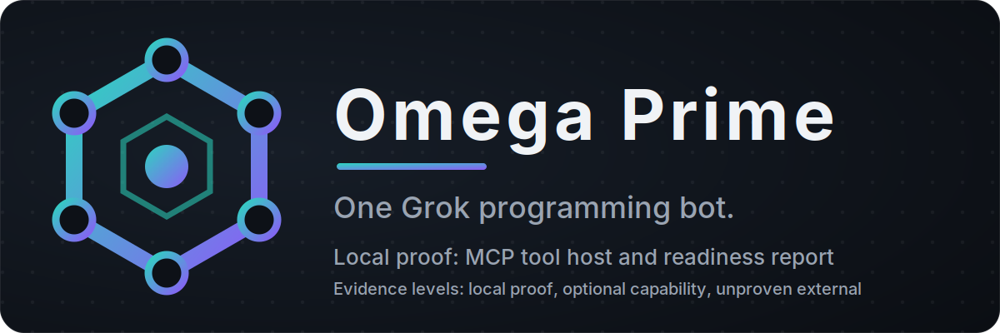

# Omega Prime for Grok Bot

The setup path is documented in [SETUP.md](../SETUP.md). Live Grok Bot import is UNPROVEN. The user UAT rows in [user UAT](../../../docs/grok-bot-native.md#user-uat) must be run on your own accounts before any live claim holds.

## What it is

Omega Prime is one Python process with one tool registry, an MCP tool host and a Grok Bot template. The evidence for this description is claims-table row 9 below.

## Install

The install prompt is in [prompts/install.md](prompts/install.md). Paste that prompt as one message into the default Grok Bot. This page does not repeat the prompt text.

## Follow-up prompts

After the install, the [follow-up index](prompts/follow-up/INDEX.md) lists five prompts. Each prompt sends one `/omega-*` command as the whole message.

## Commands

Send `/omega-*` commands as the whole message, with any arguments after a space. The prompting contract is in [SETUP.md](../SETUP.md), section 1. The evidence for this contract is claims-table row 10 below.

## Claims and evidence

Each row names its evidence level and its source file.

| Claim | Evidence level | Source |
| --- | --- | --- |
| The stdio verifier spawns the declared [mcp.json](../../../mcp.json) command and checks its `initialize` and `/omega-help` replies. The recorded tests use a stub host, not the real launcher on a checkout | local proof | Observed run: `.venv/bin/python -m pytest omega_prime/tests/test_grokbot_plugin.py -q -k 'verify_stdio or stdio'`, exit 0 (4 passed). Source: [plugin.py](../../tooling/plugin.py), function `verify_stdio`; launcher [grokbot-1click.sh](../../scripts/grokbot-1click.sh) |
| The generated plugin files match their sources at the recorded check | local proof | Observed run: `.venv/bin/python -m omega_prime.tooling.plugin --check`, exit 0 (65 generated files up to date). Source: [plugin.py](../../tooling/plugin.py) |
| The readiness report accounts for every roster tool with no Grok account and no live credentials | local proof | [Local validation](../../../docs/local-validation.md) |
| Prime capability families are off until enabled | optional capability | [Developer guide](../../../docs/developer-guide.md#configuration), Configuration |
| The Red Team backend is started separately and never auto-launched by Omega Prime | optional capability | [Red team module](../../../docs/red-team.md) |
| A custom Command (stdio) server runs on the computer each Bot conversation uses | UNPROVEN | Documented source [team bots](https://docs.x.ai/grok-bot/team-bots); [SETUP.md](../SETUP.md), section 1 Evidence paragraph. No route in this repository exercises it |
| The Bot adds the server itself, and a live Bot runs the install prompt | UNPROVEN | [user UAT](../../../docs/grok-bot-native.md#user-uat), rows 1 and 5 |
| Cursor documents Import from Repo for Teams and Enterprise plans. Whether `omega-prime` appears and loads in a Bot is UNPROVEN | PARTIAL | [SETUP.md](../SETUP.md), "Secondary: Cursor Teams/Enterprise Import from Repo"; [user UAT](../../../docs/grok-bot-native.md#user-uat), rows 2 to 4 |
| The repository runs one Python process with one tool registry and an MCP tool host, served over stdio and a remote listener, with a Grok Bot template | local proof | [architecture](../../../docs/architecture.md), "The shape"; [plugin.py](../../tooling/plugin.py), functions `verify_stdio` and `verify_https`; template [OMEGA_PRIME.md](../templates/OMEGA_PRIME.md) |
| Each `/omega-*` command is sent as the whole message and routed through the `omega_command` tool | local proof | [omega-help.md](../plugin/commands/omega-help.md) (generated, and checked for drift by `plugin.py --check`); [SETUP.md](../SETUP.md), "Prompting contract" |
| The banner and icons are repository brand art, not screenshots | local proof | [banner.svg](banner.svg), the banner source added to this folder by Phase 97; [icon-512.png](icons/icon-512.png) |
| The follow-up prompts send only `/omega-roster`, `/omega-help`, `/omega-code-review` and `/omega-doctor`, and each of those has a command file | local proof | [follow-up index](prompts/follow-up/INDEX.md); [command files](../plugin/commands/) |

## Images

The banner and icons are repository brand art, not screenshots. The app icon is [icons/icon-512.png](icons/icon-512.png).

## Licence and changes

The licence is described in [LICENSE.md](LICENSE.md), which points at the root [LICENSE](../../../LICENSE). The changes are recorded in [CHANGELOG.md](CHANGELOG.md).

## Not claimed here

- Live Grok Bot import.
- An entry in any Bot marketplace.
- Timing figures.
- Measured results.
- A live-session screenshot.
